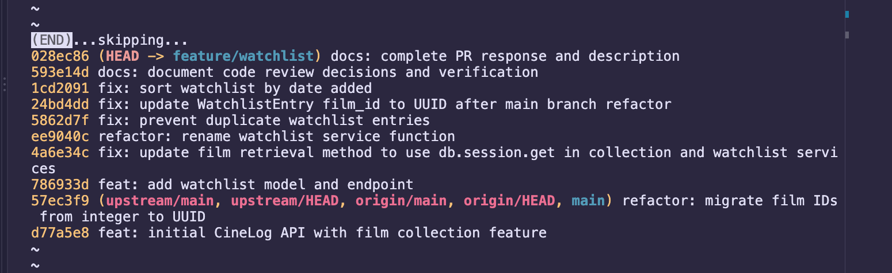

# PR Response Doc — CineLog Watchlist Feature

## AI Usage
Used AI assistance to inspect the collection model/service/test conventions, implement and verify the watchlist review changes, and organize the commit history. I reviewed the suggested changes, resolved the rebase/documentation conflicts, and ran the test suite locally; AI did not post comments or submit the PR.

## Comment 1 — Rename
**What I did:** Renamed `save_to_watchlist()` to `add_to_watchlist()` in the service and updated the route import and call site to match the project's `verb_to_noun` convention.
**How I verified:** Searched the entire project for `save_to_watchlist()`. The search found its definition in `services/watchlist_service.py` and its import/call in `routes/watchlist/watchlist.py`; both were updated. A follow-up search found no remaining code references to the old name.

## Comment 2 — Deduplication
**What I did:** Followed `add_to_collection()` in `services/collection_service.py`: its duplicate check searches for an existing entry matching both `user_id` and `film_id`, then raises `AlreadyInCollectionError` when found. `add_to_watchlist()` now checks for the same user/film pair and raises `AlreadyOnWatchlistError` for a duplicate; the route returns HTTP 409 Conflict.
**How I verified:** Added `test_add_to_watchlist_duplicate_raises()`, which adds the same film twice, asserts the second call raises `AlreadyOnWatchlistError`, and checks that only one row remains. `pytest tests/test_watchlist.py tests/test_collection.py` passed (5 tests); the full `pytest tests/ -v` suite also passed (6 tests).

## Comment 3 — Missing test
**What I did:** Added `test_add_to_watchlist_nonexistent_film_raises()` using the same in-memory app/sample-user fixtures, fake UUID, and `pytest.raises(FilmNotFoundError)` assertion as `test_add_to_collection_nonexistent_film_raises()`.
**How I verified:** Used `test_add_to_collection_nonexistent_film_raises()` in `tests/test_collection.py` as the model: same isolated in-memory app and sample-user fixtures, fake UUID, and `pytest.raises(FilmNotFoundError)` assertion. Ran `pytest tests/test_watchlist.py -v`; both watchlist tests passed, including the nonexistent-film case.

## Comment 4 — Default visibility
**My position:** Keep `public=True` as the default, but treat it as a deliberate product choice rather than an incidental model default.
**Reasoning:** This community film-tracking app should make it easy for users to share what they want to watch and discover films through other users' lists. A public default optimizes for users who add films to participate in that shared discovery, without making them configure visibility on every entry. The API should still allow an entry to be made private when a user wants that control.
**Tradeoff acknowledged:** A private-by-default policy would better protect users who consider their interests personal, and avoids exposing a list before the user makes an explicit choice. The cost is less immediate sharing and discoverability, plus added friction for users who intend to participate publicly. Because this feature is community-oriented, I favor public-by-default here, while recognizing that a privacy-first product should reverse that choice.

## Comment 5 — Sort order
**My position:** Use newest-added-first ordering, matching the reviewer's preference; `get_watchlist()` now orders entries by `date_added` descending.
**Reasoning:** Recently saved films are likely to be the most immediately relevant. This also keeps watchlist behavior consistent with `get_collection()`, which already returns entries newest first.
**Engagement with reviewer's point:** The reviewer noted that users usually want to see what they added recently. I agree that this is a better default than alphabetical order for a watchlist centered on films saved for later. Alphabetical ordering may still help users browse a large list, but it can be added later as an optional sort rather than overriding the recent-first default. Verified with `test_get_watchlist_returns_newest_first()`, which uses titles whose alphabetical order differs from their `date_added` order.

## Comment 6 — Rebase
**What conflicted:** During the earlier rebase onto the UUID refactor, `WatchlistEntry.film_id` conflicted: the feature side declared `Integer`, while main declared `String(36)` to match UUID-based `Film.id`.
**How I resolved it:** Kept main's UUID-compatible `String(36)` foreign key. For this review request, fetched `origin` and ran `git rebase origin/main`; it completed without replay conflicts because `origin/main` was already an ancestor of the feature branch. Then committed the remaining stale integer references separately: the service documents `film_id` as a UUID string and the route documents a UUID request value. Commit: `fix: update WatchlistEntry film_id to UUID after main branch refactor` (`692de28`).
**How I verified no conflict remains:** `Film.id`, `CollectionEntry.film_id`, and `WatchlistEntry.film_id` are UUID-compatible `String(36)` columns; the service and route no longer document integer film IDs. `git log --merges origin/main..HEAD` returned no merge commits. The full `pytest tests/ -v` suite passed after restoring the sort-order work (7 tests).



## PR Description

### What this does
Adds a watchlist so users can save films they want to watch later, separate from their collection of films they've already logged. `POST /watchlist/<user_id>/add` saves a film by UUID, and `GET /watchlist/<user_id>` returns the saved films with each entry's `date_added` and `public` flag. Adding a film that doesn't exist returns 404, and adding a film that's already on the user's watchlist returns 409, the same way the collection endpoints behave.

### Design decisions
1. **Visibility default: public.** New watchlist entries are created with `public=True`. CineLog is a community app, and public watchlists let people find films through each other's lists without changing a setting on every entry. The tradeoff is that someone who thinks of their watchlist as personal is sharing it before making a choice. This PR doesn't add an endpoint for making an entry private; that would be a follow-up. A privacy-first product would make the opposite choice.
2. **Sort order: newest added first.** `get_watchlist()` orders by `date_added` descending. Films saved recently are usually the ones the user cares about right now, and this matches `get_collection()`, which also returns newest first. Alphabetical order would help when browsing a long list, so it could be added later as an optional sort, not as the default.

### How to test manually
1. Install dependencies and seed a database:
   ```bash
   pip install -r requirements.txt
   python seed.py
   ```
   Note the `user_id` that `seed.py` prints for the `demo` user.
2. Start the app: `python app.py` (serves on `http://localhost:5000`).
3. List films and copy two film `id` values:
   ```bash
   curl http://localhost:5000/films/
   ```
4. Add the first film:
   ```bash
   curl -X POST http://localhost:5000/watchlist/<user_id>/add \
     -H "Content-Type: application/json" -d '{"film_id": "<film_id_1>"}'
   ```
   Expect **201** and an entry with `"public": true`.
5. Wait a second, then repeat step 4 with `<film_id_2>`. Expect **201**.
6. Repeat step 4 with `<film_id_1>` again. Expect **409** with an "already on this user's watchlist" error.
7. Repeat step 4 with `{"film_id": "00000000-0000-0000-0000-000000000000"}`. Expect **404** with a "No film found" error.
8. Repeat step 4 with an empty body `{}`. Expect **400** with "film_id is required".
9. Get the watchlist:
   ```bash
   curl http://localhost:5000/watchlist/<user_id>
   ```
   Expect two films, each with `date_added` and `"public": true`, and film 2 listed **before** film 1 (newest first).
10. Run the automated tests: `pytest tests/ -v` (7 tests should pass).
